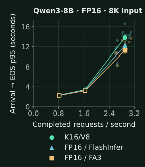

# Dense Qwen3 HTTP serving: latency, throughput and reliability

Supported comparisons: 1K closed-32 throughput versus Native FlashInfer. The 8K study fails the all-requests/all-observations validity requirement; failures remain part of the result.

| Input | Primary metric | Native control | Median improvement | Median interval | Holm p | Frozen-rule result |
| --- | --- | --- | --- | --- | --- | --- |
| 8K | Closed-32 throughput | Native FlashInfer | +3.562% | [+3.297%, +3.840%] | 0.00390625 | Not supported |
| 8K | Near-load arrival p95 reduction | Native FlashInfer | -4.336% | [-14.896%, -2.812%] | 1 | Not supported |
| 8K | Closed-32 throughput | Native FA3 | +1.647% | [+1.520%, +3.682%] | 0.00390625 | Not supported |
| 8K | Near-load arrival p95 reduction | Native FA3 | -12.649% | [-24.011%, -9.021%] | 1 | Not supported |
| 1K | Closed-32 throughput | Native FlashInfer | +1.013% | [+0.254%, +1.193%] | 0.0429688 | Supported |
| 1K | Near-load arrival p95 reduction | Native FlashInfer | -0.191% | [-1.073%, +0.293%] | 1 | Not supported |
| 1K | Closed-32 throughput | Native FA3 | -0.262% | [-1.020%, +0.614%] | 1 | Not supported |
| 1K | Near-load arrival p95 reduction | Native FA3 | -5.830% | [-7.210%, -4.948%] | 1 | Not supported |

Positive effects mean improvement; negative latency effects mean worse p95. Intervals reflect matched-block variation. The four hypotheses are corrected together within each context study; the two contexts are separately frozen experiments. Any failed request blocks an unqualified superiority claim. A failed rule is not an equivalence test.

Open-loop throughput includes drain; latency is conditional on valid completion. Hollow low/moderate points have one run per arm. Near-load faint points show all ten runs and filled points show their medians. Percentage effects use paired-block ratios, not ratios of these plotted medians. These are finite-load tradeoffs, not maximum sustainable-rate estimates. The matching [1K plot](assets/asymmetric-http-1k-20261019.svg) and complete per-cell data are linked below.

This study measures the client-visible cost of complete requests. All paths
use dense FP16 Qwen3-8B weights and FP16 compute on one H100 SXM 80 GB per
context study. K16/V8 means FP16 keys and E4M3 FP8 values. The controls store
FP16 keys and values and use either native FlashInfer or verified native
FlashAttention 3 (FA3). These are pinned experimental sources, not a claim
about the latest released vLLM.

[Current guide](asymmetric-quantization.html) · [Installation](asymmetric-install.html) ·
[Earlier batched results](asymmetric-methods.html) ·
[Arrival-trace reproduction instructions](https://github.com/mcgrof/knlp/tree/main/tools/kv/native/fixtures/serving)

## Qualification before timing

The 8K actual HTTP worker passes production qualification, prediction-loss
(NLL), retrieval and the full GSM8K preservation gate against both controls.
It also matches serial in-process outputs for 32 frozen prompts in both
reference orders. The candidate scores 1,179/1,319 strict GSM8K answers
correct, versus 1,175 for each native control. Each paired comparison has
12 losses and 16 gains; its one-sided 95% gross-loss upper bound is 1.470%,
below the frozen 2% limit. This bound concerns loss transitions across all
questions, not net accuracy change. Retrieval scores are 96/100 in all
three paths. NLL upper bounds are +0.000758 and +0.000640, below `ln(1.01)`.
The full GSM8K task uses natural question lengths and natural completion.

The worker loads the original effective scales before warmup and graph
capture. Qualification checks physical FP16 K/FP8 V storage without a full
FP16 V shadow, weight dispatch, actual FA3 dispatch, changing graph inputs,
output placement, fresh-prefill routing and idle/mixed admission. Heavy
numerical checks and profiling are outside primary timing. Native controls
use unit value scales because their values are unquantized.

The separate 1K HTTP qualification also passes all three quality gates and
32-prompt serial parity in both reference orders. Strict GSM8K counts are
1,179/1,319 for the candidate, 1,176 for FlashInfer and 1,173 for FA3.
The paired losses/gains are 11/14 and 8/14, with one-sided 95% gross-loss
upper bounds of 1.377% and 1.092%. Retrieval is 100/100 for every arm;
the NLL upper bounds are +0.001240 and +0.001278.

Quality preservation here means passing these finite, frozen paired tests.
It is not mathematical equivalence or a universal accuracy guarantee.
The strict GSM8K extractor has its disclosed terminal-dot limitation.
AWQ HTTP has a separate [failed preservation result](asymmetric-methods.html#awq-http-quality),
so it has no HTTP performance confirmation in this study.

## Fixed workloads and decision rules

All timing requests have exactly 1,024 or 8,192 input tokens and 128 forced
output tokens. The public prompt panels contain 32 fixed documents per
context. Output EOS is ignored only for these forced-length timing requests.
The model, tokenizer, calibrated scales, sampling, prompts and arrival
schedule are identical across arms within a comparison. There is one GPU
worker, tensor parallelism one, 22 CPU threads, page size 16 and NHD layout.
Automatic prefix caching and chunked prefill are disabled. The engine has
`max_num_seqs=96`, `max_num_batched_tokens=65536` and `FULL_DECODE_ONLY`
graph policy. HTTP streaming requests interval one and returns token IDs.

The 8K persistent KV budget is 40 GiB per arm. The 1K study uses 32 GiB.
The two context studies use different physical H100s, with effective CPU
quotas of 31.45 and 23.8 cores respectively. Both preserve 22 Torch threads.
Cross-context rates therefore are not paired measurements on the same
physical system. Within each study all three paths share one GPU and CPU
allocation, with no overlapping GPU experiments.

| Input | Cell | Offered load / policy | Requests / cell / arm | Replications |
| --- | --- | --- | --- | --- |
| 8K | Open low / moderate | 0.8 / 1.6 req/s | 128 each | 1 descriptive run / arm |
| 8K | Open near | 2.9 req/s | 512 | 10 blocks / arm |
| 8K | Closed concurrency 32 | Up to 32 in flight | 512 | 10 blocks / arm |
| 1K | Open low / moderate | 3.7 / 8.1 req/s | 128 each | 1 descriptive run / arm |
| 1K | Open near | 14.9 req/s | 768 | 10 blocks / arm |
| 1K | Closed concurrency 32 | Up to 32 in flight | 768 | 10 blocks / arm |

Each context also has one descriptive isolated cell with eight requests five seconds apart and one closed-concurrency-8 cell with 128 requests per arm. Every study has 33 fresh server invocations: 30 confirmation and three descriptive.

For 1K, the excluded native closed-32 pilots measure 16.6504 and 16.8997 requests/s. The same 90%-of-slower-native formula gives 14.9 offered requests/s. Low/moderate loads are 25%/55% of that rate, rounded down to tenths. The count is at least 512 and approximately 45 seconds at the faster native pilot, rounded up to a multiple of 32: 768 requests. Candidate outcomes do not select rates or counts.

For 8K, the excluded native closed-loop pilots measure 3.2635 and 3.3398
completed requests/s. The fixed near load is `floor(10 * 0.9 * min(rate)) / 10`,
or 2.9 offered requests/s. Candidate timing does not select the load. The
low and moderate offered loads are 0.8 and 1.6 requests/s. A Poisson trace
specifies explicit nanosecond offsets; the realized finite arrival rate need
not equal its generating rate exactly. Every arm gets identical offsets.

Each context's confirmation has ten fresh, counterbalanced blocks. Each
arm starts a new server and warms with one non-streaming batched API call
containing 32 prompts, each generating 128 forced tokens. The warmup file
supplies those prompts; its concurrency field is not used to issue separate
HTTP calls. Latency measurements begin after server startup and warmup.
Each measured cell follows a two-second settling interval.
The order of closed concurrency 32 and open near-load cells alternates
across blocks. One separate run per arm covers
the descriptive isolated, closed concurrency 8, low and moderate cells.
Descriptive cells and excluded pilots do not enter primary tests.

The primary family has four hypotheses: closed-loop completed throughput
and near-load intended-arrival p95 latency against each of the two native
controls. The exact one-sided sign test uses independent matched blocks;
ties count as nonwins. Holm correction includes all four hypotheses at
0.05. Throughput needs a 1% median improvement, and latency needs 5%.
These median screens are separate from the uncertainty interval. With ten
blocks, the distribution-free median interval uses the second and ninth
ordered effects, attaining at least 97.8516% coverage under the stated
independent-block model. These are pointwise intervals; Holm adjustment
applies to the four sign tests. Requests and tokens are not extra replicates.

All ten blocks are fixed before confirmation. There is no optional stop,
replacement block or addition until a result passes. Request and drain
timeouts are 300 seconds, with zero retries. A failed request prevents an
unqualified benefit claim under the frozen rule. The full matrix retains
failures alongside conditional latency, even when statistical throughput
or median screens pass.

## What each latency and throughput measure means

The client and server run on the same host and communicate over loopback.
All client measurements use one monotonic clock. Intended arrival,
dispatch, semaphore admission, HTTP send, response headers, each received
stream event, last token-bearing event and end-of-stream are retained.
Server times are not subtracted from client times.

- **TTFT:** time to the first token-bearing event, from HTTP send or from
  intended arrival. Protocol-only empty chunks do not count as tokens.
  Token-bearing events can have no visible text.
- **TPOT:** each request's time from first to last token-bearing event,
  divided by output tokens minus one. Report p50/p95 across those per-request
  averages. This is not a percentile of individual token gaps.
- **End-to-end latency:** time to the single `[DONE]` end-of-stream marker,
  from HTTP send or intended arrival. Last content and stream completion
  are separate endpoints.
- **Stream gaps:** intervals between actual token-bearing event timestamps.
  A multi-token chunk does not reveal its internal token times. Network or
  event-loop coalescing can give zero visible gaps. Empty and multi-token
  event counts remain explicit.
- **Finite throughput:** valid completed requests or their output tokens
  divided by the complete observation interval, including final drain.
  Below saturation, equal offered load can produce nearly equal completed
  rates even when latency differs substantially.

Open-loop clients have neither a concurrency semaphore nor a connector
limit. Closed-loop clients retain concurrency 8 or 32. All closed-loop
requests are intended at the initial timestamp, so intended-arrival latency
includes waiting for that client semaphore; send-based latency removes
that wait. Client concurrency is not GPU batch size. The raw worker records
supply actual fresh admissions, scheduled request counts and preemptions.

The excluded observer checks compare lightweight recording with its step
metadata disabled. Their dense-8K throughput differences are +0.134%,
+0.061% and +0.179% for candidate, FlashInfer and FA3 respectively. These
single descriptive checks do not establish zero observer effect. All
confirmation arms use the same recorder. The separate 1K observer checks
give −0.740%, +0.510% and +0.644% respectively; they likewise do not prove
zero overhead. Dispatch lag, admission waits and
server metric errors remain available for every final cell.

### Reliability and secondary measurements

| Input | Arm | Offered | Completed | Errors | Timeouts | Cancelled | Unfinished | Invalid | Preemptions |
| --- | --- | --- | --- | --- | --- | --- | --- | --- | --- |
| 8K | K16/V8 | 10632 | 10628 | 4 | 0 | 0 | 0 | 0 | 29 |
| 8K | Native FlashInfer | 10632 | 10629 | 3 | 0 | 0 | 0 | 0 | 0 |
| 8K | Native FA3 | 10632 | 10627 | 5 | 0 | 0 | 0 | 0 | 0 |
| 1K | K16/V8 | 15752 | 15752 | 0 | 0 | 0 | 0 | 0 | 0 |
| 1K | Native FlashInfer | 15752 | 15752 | 0 | 0 | 0 | 0 | 0 | 0 |
| 1K | Native FA3 | 15752 | 15752 | 0 | 0 | 0 | 0 | 0 | 0 |

Counts include confirmation and descriptive cells, excluding warmup and pilots. Failed launches are separate from offered-request failures.

The twelve 8K failures all occur before response headers, stream events or worker admission: eleven server disconnects and one connection reset. Their cause is unproven. No request was retried. All descriptive cells complete without failures.

- 8K, block 0, K16/V8, open-near: `trace-2026101900-00346`; status `error`, worker admitted False, headers False, received events 0.
- 8K, block 2, K16/V8, open-near: `trace-2026101902-00264`; status `error`, worker admitted False, headers False, received events 0.
- 8K, block 2, K16/V8, open-near: `trace-2026101902-00468`; status `error`, worker admitted False, headers False, received events 0.
- 8K, block 3, Native FA3, open-near: `trace-2026101903-00292`; status `error`, worker admitted False, headers False, received events 0.
- 8K, block 3, Native FA3, open-near: `trace-2026101903-00301`; status `error`, worker admitted False, headers False, received events 0.
- 8K, block 6, Native FlashInfer, open-near: `trace-2026101906-00108`; status `error`, worker admitted False, headers False, received events 0.
- 8K, block 6, Native FA3, open-near: `trace-2026101906-00483`; status `error`, worker admitted False, headers False, received events 0.
- 8K, block 7, Native FA3, open-near: `trace-2026101907-00490`; status `error`, worker admitted False, headers False, received events 0.
- 8K, block 7, K16/V8, open-near: `trace-2026101907-00159`; status `error`, worker admitted False, headers False, received events 0.
- 8K, block 8, Native FA3, open-near: `trace-2026101908-00421`; status `error`, worker admitted False, headers False, received events 0.
- 8K, block 8, Native FlashInfer, open-near: `trace-2026101908-00091`; status `error`, worker admitted False, headers False, received events 0.
- 8K, block 8, Native FlashInfer, open-near: `trace-2026101908-00429`; status `error`, worker admitted False, headers False, received events 0.

| Input | Arm | Completed req/s | TTFT p50 ms | TTFT p95 ms | TPOT p50 ms | TPOT p95 ms | Arrival-to-EOS p50 ms | Arrival-to-EOS p95 ms |
| --- | --- | --- | --- | --- | --- | --- | --- | --- |
| 8K | K16/V8 | 2.8930 | 567.82 | 2056.74 | 46.43 | 97.14 | 6620.08 | 13808.56 |
| 8K | Native FlashInfer | 2.8967 | 684.36 | 3021.97 | 51.46 | 81.77 | 7803.07 | 12204.97 |
| 8K | Native FA3 | 2.8960 | 589.85 | 2446.98 | 46.26 | 79.02 | 6689.60 | 11266.50 |
| 1K | K16/V8 | 14.3911 | 64.35 | 114.29 | 12.16 | 15.43 | 1610.04 | 2041.99 |
| 1K | Native FlashInfer | 14.3917 | 60.84 | 111.82 | 12.12 | 15.47 | 1604.22 | 2039.23 |
| 1K | Native FA3 | 14.3970 | 52.12 | 103.56 | 11.65 | 14.50 | 1539.72 | 1916.98 |

These are medians across the ten near-load block summaries. TTFT is from intended arrival; all latency columns condition on valid completion. They do not pool requests across blocks.

| Input | Arm | Completed near-load requests | Token-bearing events | Multi-token events | Event-gap p50 ms | Event-gap p95 ms |
| --- | --- | --- | --- | --- | --- | --- |
| 8K | K16/V8 | 5116 | 654746 | 60 | 15.343 | 236.867 |
| 8K | Native FlashInfer | 5117 | 654841 | 94 | 18.166 | 240.201 |
| 8K | Native FA3 | 5115 | 654661 | 59 | 15.983 | 246.752 |
| 1K | K16/V8 | 7680 | 983040 | 0 | 8.725 | 28.604 |
| 1K | Native FlashInfer | 7680 | 983018 | 22 | 8.844 | 27.831 |
| 1K | Native FA3 | 7680 | 983000 | 40 | 8.674 | 25.536 |

Event counts sum all ten near-load captures; gap columns are medians of their per-capture quantiles. Actual multi-token events occur despite requesting stream interval one. Their interior token times are unobserved, so these distributions are client-visible event gaps, not token-level tail latency.

| Input | Arm | Dispatch lag p95 ms | Admission wait p95 ms | Peak outstanding | Outstanding at arrival end | Drain seconds |
| --- | --- | --- | --- | --- | --- | --- |
| 8K | K16/V8 | 1.811 | 0.024 | 55.5 | 14.5 | 1.885 |
| 8K | Native FlashInfer | 1.806 | 0.023 | 48.5 | 19.0 | 1.935 |
| 8K | Native FA3 | 1.809 | 0.024 | 47.0 | 14.5 | 1.878 |
| 1K | K16/V8 | 1.323 | 0.021 | 46.5 | 21.5 | 1.071 |
| 1K | Native FlashInfer | 1.322 | 0.021 | 46.0 | 21.5 | 1.060 |
| 1K | Native FA3 | 1.325 | 0.021 | 43.5 | 21.0 | 1.032 |

Queue columns are medians of the ten near-load block summaries; the CSV and JSON retain every value. Lightweight recording and loopback remove neither host work nor observer effects. Actual GPU scheduler cohort histograms and stream-event multiplicities remain in JSON.

| Input | Arm | New-admission steps | Also decoding | Mixed share | Most common fresh cohort | Largest fresh cohort | Resumed events |
| --- | --- | --- | --- | --- | --- | --- | --- |
| 8K | K16/V8 | 3823 | 3767 | 98.54% | 1 | 7 | 29 |
| 8K | Native FlashInfer | 3866 | 3818 | 98.76% | 1 | 7 | 0 |
| 8K | Native FA3 | 3811 | 3753 | 98.48% | 1 | 7 | 0 |
| 1K | K16/V8 | 6775 | 6765 | 99.85% | 1 | 5 | 0 |
| 1K | Native FlashInfer | 6813 | 6803 | 99.85% | 1 | 6 | 0 |
| 1K | Native FA3 | 6837 | 6827 | 99.85% | 1 | 5 | 0 |

These diagnostic counts sum the ten near-load captures per arm; steps are not independent statistical replicates. Fresh means a newly admitted request, separate from recomputation after preemption. The complete histogram supplement also records closed-loop and descriptive cells. Scheduling evidence alone does not attest kernel dispatch or CUDA graph replay.

### Matched profiles outside confirmation

The completed studies trigger the predeclared near-load p95 regression
diagnostic. Each context gets exactly one profile per arm, after the full
first-block closed-32 prelude, using the first 64 original open arrivals.
All 64 requests complete in each profile. The independent reader verifies
the exact parent result, frozen plan, source, dense weights and unchanged
per-arm protocol before reading traces. These profiles are excluded from
confirmation and do not add statistical replicates.

| Input | Arm | Scheduler steps | Matrix ms | Attention / merge ms | Cache writer ms | Gather / cast ms | Graph launches | Unmatched kernels |
| --- | --- | --- | --- | --- | --- | --- | --- | --- |
| 8K | K16/V8 | 509 | 12543.57 | 5900.20 | 81.05 | 43.53 | 462 | 5577 |
| 8K | Native FlashInfer | 469 | 12365.40 | 6438.46 | 166.22 | 0.00 | 419 | 5137 |
| 8K | Native FA3 | 522 | 12834.81 | 5991.49 | 173.15 | 0.00 | 470 | 5720 |
| 1K | K16/V8 | 353 | 2927.06 | 673.23 | 26.74 | 5.86 | 300 | 3861 |
| 1K | Native FlashInfer | 363 | 2974.58 | 700.24 | 43.24 | 0.00 | 310 | 3971 |
| 1K | Native FA3 | 396 | 3167.80 | 714.30 | 46.29 | 0.00 | 341 | 4334 |

Durations are sums over GPU kernels classified by name, including kernels
outside matched phase ranges. Their units are milliseconds across the
whole capture, not per-request latency. CUDA correlations join matched
kernels to actual scheduler metadata; unmatched kernels remain explicit.
The archived result separates prefill/mixed and decode work, all kernel names,
host execute ranges and CUDA API calls. Different scheduler-step counts
mean the arms realize different schedules under the same offered trace.
Host execute ranges can overlap and include waits or asynchronous work;
their sums are not pure CPU compute or a causal latency decomposition.

At 1K, matrix multiplication is about 72% of candidate summed kernel time.
Gather including fused value casting is only 5.86 ms, about 0.14%. The
candidate's summed GPU kernel duration is lower than FA3's in this capture,
while its client p95 is worse. That observation does not isolate a kernel
fix for the tail regression. Graph launches remain visible in all three
paths. Captured graphs can bypass Python wrappers, so missing wrapper rows
do not establish fallback or missing attention. In particular, native FA3
does not use the instrumented FlashInfer Python wrapper.

At 8K, candidate gather/cast is 43.53 ms, about 0.21% of its
20.65 seconds of summed kernel time. The native sums are 20.92 seconds
for FlashInfer and 21.01 seconds for FA3. FA3 has shorter recorded host
execute ranges and better client p95 despite its slightly larger GPU sum.
The profile does not isolate a safely removable host cost. All three short
captures have zero preemption; they do not reproduce the 29 candidate
preemptions in seven longer primary traces. Those events remain explicit
in the full scheduler and reliability evidence.

Client dispatch, client admission waits, sampled server queues, actual
admissions and preemptions are retained separately. Coarse queue scrapes
cannot exclude short waits. Profiling adds overhead and changes realized
schedules, so these six diagnostic captures do not replace the unprofiled
paired measurements. No bounded implementation defect is established and
no post-result kernel search or extra confirmation blocks are added.

No production latency objective was supplied. No goodput target is selected
after seeing results. Backlog quarters, peak outstanding work, queue area,
server waiting/running gauges and final drain describe a finite trace.
They do not establish queue stability at a maximum sustainable rate.

## Memory and source scope

Physical backing bytes and logical token slots are checked before and after
each arm's timing. K16/V8 saves 25% persistent payload at equal token slots;
a fixed byte pool instead gives approximately one third more slots. The
candidate adds 256 MiB of prefill staging plus its other workspaces. There
is no maximum request-residency sweep or 25% total-GPU-memory claim.

Torch memory values are peaks since each measurement reset. The common HTTP
driver audit uses snapshots at recorded observation points, not a continuous
startup-to-shutdown peak. Server Prometheus gauges are
sampled once per second; sampled maxima can miss shorter events. Exact
per-cell preemption counts come from worker receipts.

| Input | Arm | Physical KV bytes | Token slots / layer | Staging MiB | Maximum recorded Torch reserved peak GiB | Maximum observed driver GiB |
| --- | --- | --- | --- | --- | --- | --- |
| 8K | K16/V8 | 42,948,624,384 | 388,352 | 256 | 67.084 | 67.833 |
| 8K | Native FlashInfer | 42,948,624,384 | 291,264 | 0 | 66.803 | 67.550 |
| 8K | Native FA3 | 42,948,624,384 | 291,264 | 0 | 66.957 | 67.704 |
| 1K | K16/V8 | 34,359,607,296 | 310,688 | 256 | 56.537 | 54.268 |
| 1K | Native FlashInfer | 34,358,427,648 | 233,008 | 0 | 56.256 | 54.241 |
| 1K | Native FA3 | 34,358,427,648 | 233,008 | 0 | 56.254 | 53.786 |

Memory maxima here are across the captured arm invocations at their documented observation points. Their different scopes must not be treated as simultaneous allocations or subtracted to infer an unmeasured component. Logical slots are not a measured maximum resident request count.

The separate 1K driver sample supplement covers all 33 full command windows, including startup and shutdown. Its observed maxima are 57.276, 56.995 and 56.993 GiB for K16/V8, FlashInfer and FA3. All windows meet the stated sampling-coverage flag and every observed value remains inside its driver envelope. These one-second observations can miss shorter peaks. The 8K sampler did not cover confirmation; its boundary observations above do not establish a continuous driver peak.

| Component | Exact revision |
| --- | --- |
| 8K harness | 0e34f048a82420a3a7b7a5d6d27254d4cd7692b8 |
| 1K harness | 9a531755ae4da676bd6965d68b9c1af70f6966b2 |
| Candidate vLLM | 276305b29e0d11f95ada503ba76323ab24992e59 |
| Native vLLM (both controls) | c21c0878210695db7b108cdc285aaf0cf890190a |
| FlashInfer | 800a550f8b736e49f8cfa136b82bfaf6d9d32711 |
| Qwen3-8B model/tokenizer | b968826d9c46dd6066d109eabc6255188de91218 |
| CPU audit, replay and profile tools | 5b0f39f28107babcdbbd1f7efded1c690b4f6eb2 |

Python 3.12.11, Torch 2.11.0+cu129, Transformers 5.5.3, NumPy 1.26.4. The full model snapshot was verified before the 1K study, which uses offline loading; 8K retained its original online startup environment. Per-arm protocol hashes and physical memory inventories are retained in the data.

- **8K:** full independent evidence JSON, unpooled matrix CSV, scheduler admission JSON, matched profile JSON, [plot SVG](assets/asymmetric-http-8k-20261019.svg).
- **1K:** full independent evidence JSON, unpooled matrix CSV, scheduler admission JSON, matched profile JSON, [plot SVG](assets/asymmetric-http-1k-20261019.svg).

The [CPU evidence tools](https://github.com/mcgrof/knlp/tree/main/tools/kv/native/fixtures/serving)
independently replay raw clients, worker admission and source/input hashes.
The separately supplied trace catalog restores every original byte and rejects changed
inputs. Two CPU reader corrections validate the measured structured FP16
weight inventory and distinguish resumed requests that the pinned V2
scheduler sends through its new-request field. Neither correction changes
GPU execution or the statistical rule. The complete 1K replay check reproduces every result
field except the reader's own hash; its original profile parent is retained. A new execution is a replication, with its own qualification and
frozen plan; historical success receipts do not qualify changed code.

The [replication procedure](https://github.com/mcgrof/knlp/blob/main/tools/kv/native/fixtures/serving/REPRODUCE.md) requires separately supplied archived inputs and original measured source. It describes source checkout, full-snapshot preparation, all three production/quality/reference commands, fixed design and independent result reader. Its CPU plan builder reruns both evidence audits before emitting plans.
