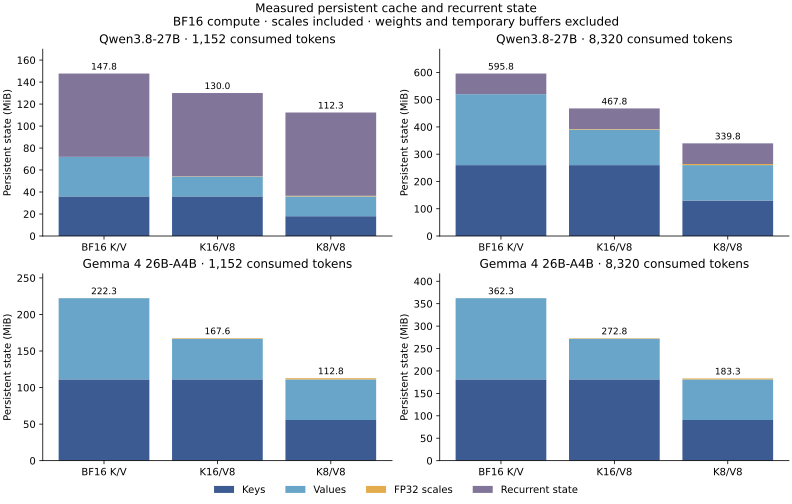

# Recent popular models: physical asymmetric KV reference

This study tests whether keeping keys at BF16 gives a useful quality advantage over quantizing both keys and values to FP8. It measures two pinned recent checkpoints with a physical Transformers reference cache: Qwen3.8-27B and Gemma 4 26B-A4B. The fixed panels do not establish a distinctive K16/V8 advantage.

Qwen3.8-27B: both K16/V8 and K8/V8 pass every frozen preservation limit. K8/V8 saves twice as many persistent-state bytes as K16/V8, including scales. This panel gives no demonstrated reason to spend the extra cache bytes on BF16 keys.

Qwen3.8-27B: the corrected direct GSM8K comparison does not establish an accuracy difference between K16/V8 and K8/V8.

Gemma 4 26B-A4B: neither candidate clears every frozen preservation limit. Both pass the math and retrieval gates; prediction-loss bounds prevent joint qualification. The failed certificate does not prove general quality harm.

Gemma 4 26B-A4B: the corrected direct GSM8K comparison does not establish an accuracy difference between K16/V8 and K8/V8.

Preservation and direct superiority are different questions. A passing preservation gate is a finite-panel result. A failed gate does not prove general inferiority or equivalence. These runs qualify a Transformers reference, not a fused production serving path.

K16/V8 and K8/V8 have different memory budgets. This study does not include an equal-budget K8/V16 control, so it does not establish that keys specifically deserve the extra precision. If both candidates pass the fixed preservation rules, K8/V8 provides greater persistent-state savings on the measured panels; that does not establish general quality equivalence.

## Quality preservation

| Model | Candidate | All gates | Native GSM8K | Candidate GSM8K | Losses / gains | Gross-loss upper |
| --- | --- | --- | --- | --- | --- | --- |
| Qwen3.8-27B | BF16 K / FP8 V | Pass | 1268/1319 | 1273/1319 | 1 / 6 | 0.483% |
| Qwen3.8-27B | FP8 K/V | Pass | 1268/1319 | 1277/1319 | 3 / 12 | 0.736% |
| Gemma 4 26B-A4B | BF16 K / FP8 V | Not established | 1270/1319 | 1272/1319 | 3 / 5 | 0.736% |
| Gemma 4 26B-A4B | FP8 K/V | Not established | 1270/1319 | 1271/1319 | 7 / 8 | 1.181% |

The GSM8K upper limit is 2%. Every candidate must also pass both retrieval and both prediction-loss gates, with native accuracy at least 50%. One-sided alpha is 0.0125 for each candidate/model.

## Direct candidate comparison

| Model | Only K16/V8 correct | Only K8/V8 correct | K16/V8 net difference | Exact two-sided p | Holm p |
| --- | --- | --- | --- | --- | --- |
| Qwen3.8-27B | 4 | 8 | -0.303 pp | 0.387695 | 0.775391 |
| Gemma 4 26B-A4B | 5 | 4 | 0.076 pp | 1 | 1 |

Holm correction covers the two direct model comparisons. Accuracy differences are percentage points. No direct test of production speed was planned.

## Prediction loss

| Model | Candidate | Prefill tokens | Native mean NLL | Candidate mean NLL | Relative change | Upper bound | Rule |
| --- | --- | --- | --- | --- | --- | --- | --- |
| Qwen3.8-27B | BF16 K / FP8 V | 1024 | 1.765788 | 1.766032 | 0.014% | 0.089% | Pass |
| Qwen3.8-27B | BF16 K / FP8 V | 8192 | 1.859394 | 1.858540 | -0.046% | 0.026% | Pass |
| Qwen3.8-27B | FP8 K/V | 1024 | 1.765788 | 1.766285 | 0.028% | 0.134% | Pass |
| Qwen3.8-27B | FP8 K/V | 8192 | 1.859394 | 1.859393 | -0.000% | 0.071% | Pass |
| Gemma 4 26B-A4B | BF16 K / FP8 V | 1024 | 5.199028 | 5.286669 | 1.686% | 5.735% | Fail |
| Gemma 4 26B-A4B | BF16 K / FP8 V | 8192 | 8.055013 | 8.078529 | 0.292% | 0.903% | Pass |
| Gemma 4 26B-A4B | FP8 K/V | 1024 | 5.199028 | 5.226847 | 0.535% | 4.360% | Fail |
| Gemma 4 26B-A4B | FP8 K/V | 8192 | 8.055013 | 8.110683 | 0.691% | 1.664% | Fail |

Each context uses 32 paired documents and 128 scored targets per document. The 98.75% upper bound uses 100,000 paired document resamples and seed 20261019. The limit is +1% relative mean NLL, not perplexity.

Prediction loss uses unframed raw Wikipedia text tokenized with `add_special_tokens=False`. It has no chat wrapper. Math and retrieval instead use each official chat template with thinking disabled. Absolute NLL values are not comparable across these models and tokenizers. Gemma's wider per-document perturbations and uncertainty remain in the full panel; no outlier was removed or prompt format changed after seeing results.

Gemma K16/V8 passes the 8K loss gate while K8/V8 does not, but both fail at 1K. A pass/fail difference between preservation tests is not a direct test of superiority. The study also has no equal-budget K8/V16 arm.

## Retrieval

| Model | Candidate | Input tokens | Native correct | Candidate correct | Losses / gains | Gross-loss upper | Rule |
| --- | --- | --- | --- | --- | --- | --- | --- |
| Qwen3.8-27B | BF16 K / FP8 V | 1024 | 100/100 | 100/100 | 0 / 0 | 4.287% | Pass |
| Qwen3.8-27B | BF16 K / FP8 V | 8192 | 100/100 | 100/100 | 0 / 0 | 4.287% | Pass |
| Qwen3.8-27B | FP8 K/V | 1024 | 100/100 | 100/100 | 0 / 0 | 4.287% | Pass |
| Qwen3.8-27B | FP8 K/V | 8192 | 100/100 | 100/100 | 0 / 0 | 4.287% | Pass |
| Gemma 4 26B-A4B | BF16 K / FP8 V | 1024 | 100/100 | 100/100 | 0 / 0 | 4.287% | Pass |
| Gemma 4 26B-A4B | BF16 K / FP8 V | 8192 | 100/100 | 100/100 | 0 / 0 | 4.287% | Pass |
| Gemma 4 26B-A4B | FP8 K/V | 1024 | 100/100 | 100/100 | 0 / 0 | 4.287% | Pass |
| Gemma 4 26B-A4B | FP8 K/V | 8192 | 100/100 | 100/100 | 0 / 0 | 4.287% | Pass |

Each context uses all 100 frozen prompts. The one-sided Clopper-Pearson upper limit is 5%; gains do not cancel gross losses.

## Actual persistent state memory

| Model | Consumed tokens | Arm | Unique backing MiB | State saving | Scale bytes | Recurrent bytes |
| --- | --- | --- | --- | --- | --- | --- |
| Qwen3.8-27B | 1152 | BF16 K/V | 147.750 | 0.000% | 0 | 79429632 |
| Qwen3.8-27B | 8320 | BF16 K/V | 595.750 | 0.000% | 0 | 79429632 |
| Qwen3.8-27B | 1152 | BF16 K / FP8 V | 130.031 | 11.992% | 294912 | 79429632 |
| Qwen3.8-27B | 8320 | BF16 K / FP8 V | 467.781 | 21.480% | 2129920 | 79429632 |
| Qwen3.8-27B | 1152 | FP8 K/V | 112.312 | 23.985% | 589824 | 79429632 |
| Qwen3.8-27B | 8320 | FP8 K/V | 339.812 | 42.961% | 4259840 | 79429632 |
| Gemma 4 26B-A4B | 1152 | BF16 K/V | 222.305 | 0.000% | 0 | 0 |
| Gemma 4 26B-A4B | 8320 | BF16 K/V | 362.305 | 0.000% | 0 | 0 |
| Gemma 4 26B-A4B | 1152 | BF16 K / FP8 V | 167.553 | 24.629% | 864480 | 0 |
| Gemma 4 26B-A4B | 8320 | BF16 K / FP8 V | 272.826 | 24.697% | 1151200 | 0 |
| Gemma 4 26B-A4B | 1152 | FP8 K/V | 112.801 | 49.258% | 1728960 | 0 |
| Gemma 4 26B-A4B | 8320 | FP8 K/V | 183.348 | 49.394% | 2302400 | 0 |

Consumed tokens include the 128-token teacher-forced continuation after prefill. Backing bytes include FP32 scales and unchanged recurrent state; model weights and temporary reconstruction are separate. These are not whole-GPU-memory or serving-capacity savings.

## Retained completion diagnostics

| Model | Arm | GSM8K correct / 1319 | GSM8K truncated | Missing answer label | Retrieval truncated / 200 |
| --- | --- | --- | --- | --- | --- |
| Qwen3.8-27B | BF16 K/V | 1268 | 15 | 8 | 0 |
| Qwen3.8-27B | BF16 K / FP8 V | 1273 | 11 | 8 | 0 |
| Qwen3.8-27B | FP8 K/V | 1277 | 13 | 8 | 0 |
| Gemma 4 26B-A4B | BF16 K/V | 1270 | 1 | 1 | 0 |
| Gemma 4 26B-A4B | BF16 K / FP8 V | 1272 | 0 | 0 | 0 |
| Gemma 4 26B-A4B | FP8 K/V | 1271 | 0 | 0 | 0 |

The primary parser and all panel identities were frozen before candidate outputs. No post-hoc reparsing or replacement panel determines admission.

## Validation

All 9,226 saved generation outputs were decoded again with the pinned tokenizers and checked against their saved text and scores. The audit replayed native token parity and verified physical cache dtypes, dimensions, exact scale bytes and backing bytes. Recurrent-state shapes and precision remain native. Every full-panel export passed hash verification before its allocation was deleted.

Additional CPU checks compare exact native logits against the official library through single-token and multi-token continuations, including sliding-window rollover and different local/global head dimensions. All 13 tests pass. These post-run checks change no runtime, inputs, scores or admission rules.

## Execution history

Qwen's first full-panel execution stopped during native 8K prediction loss because the multimodal wrapper reused position offsets from a prior generation batch. No quantized holdout or GSM8K rows had run. That failure and its incomplete native rows are retained. The complete Qwen panel was rerun with explicit independent text positions; no partial rows were merged. Gemma retained its original running source.

## Reproduction

The [method and direct commands](README.md) define the quantizer,
checkpoint revisions, data revisions, frozen token-input hashes,
software versions, decoding settings and statistical decision rules.
All arms use original BF16 weights and compute, with FP8 E4M3 cache
storage and independent FP32 scales per token/head. Attention uses
transient BF16 reconstruction through official scaled dot product
attention. Qwen retains its original recurrent state.

The complete measured source files are byte-identical to these commits:

| Model | Source commit |
| --- | --- |
| Qwen3.8-27B | `06712e423644a6f2f533515f918e438caa69881d` |
| Gemma 4 26B-A4B | `9b55292405f037bd71c4ce5f1f5a657491f2d1a5` |

The subsequent test expansion checks cache continuation and changes no
measured runtime. This study is independent of the optimized serving
experiments: its results cannot qualify a fused backend, predict serving
speed, or establish support for production prefix sharing.
